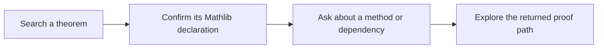

# Leanage

**Leanage** is a focused explorer for the dependency graph behind Mathlib proofs. It helps researchers and Lean users identify a formal theorem, inspect what it depends on, and follow each graph path returned by TheoremGraph.

## Run locally

```sh
npm install
npm run dev -- --port 5187 --strictPort
```

Open [http://127.0.0.1:5187/](http://127.0.0.1:5187/). [How it works](http://127.0.0.1:5187/how-it-works) explains the workflow, evidence, and limits. Vite proxies `/tg/*` to `https://api.theoremsearch.com`, so searches and neighborhood requests need an internet connection. Leanage does not build or store a complete offline graph.

```sh
npm test
npm run build
```

### Local dependency store

When `public/store/` exists, the app answers dependency questions from a local copy of the Mathlib dependency graph (complete closure, no API calls) and falls back to TheoremGraph when it is missing or the declaration is not in it. Build it once:

```sh
# download the 128 parquet shards of mathlib-initiative/mathlib-const-dep, then:
python3 scripts/ingest_const_dep.py --shards path/to/shards --out public/store --check
```

The store is gitignored (about 24 MB gzipped). It needs `pyarrow` and `numpy`. Details and validation are in [docs/IMPLEMENTATION_PLAN.md](docs/IMPLEMENTATION_PLAN.md).

Vercel serves the app at [https://leanage.vercel.app](https://leanage.vercel.app). The configuration rewrites the guide route. The site caches neighborhood responses at the CDN for one hour; semantic search remains uncached.

## Use Leanage



Search is semantic, so confirm the exact declaration. A graph path is evidence from TheoremGraph, not a proof certificate or a complete dependency closure. Recorded tactic matches are possible signals; their source revisions may differ. See [How it works](https://leanage.vercel.app/how-it-works) for interpretation and limits, and the [method validation record](docs/feasibility/method-validation.md) for source details.

## Code and decisions

- [src/api.ts](src/api.ts): API validation, timeouts, request sharing, memory cache, and bounded `429` retries.
- [src/neighborhoodCache.ts](src/neighborhoodCache.ts): bounded IndexedDB cache with expiration.
- [src/objectives.ts](src/objectives.ts): interpretation of method and exact-name questions, including existing French shared links.
- [src/methods.ts](src/methods.ts): exact graph rules, tactic metadata, version-aware evidence, and source attribution.
- [scripts/build_method_index.py](scripts/build_method_index.py): pinned, reproducible compact index builder.
- [src/explorer.ts](src/explorer.ts): layer-by-layer traversal, distinct policies, paths, cancellation, and budgets.
- [src/App.tsx](src/App.tsx): search, declaration confirmation, and traversal coordination.
- [src/WorkflowSections.tsx](src/WorkflowSections.tsx), [src/CandidateSection.tsx](src/CandidateSection.tsx), [src/ResultsSection.tsx](src/ResultsSection.tsx), and [src/Findings.tsx](src/Findings.tsx): candidate search, questions, and evidence presentation.
- [src/GraphExplorer.tsx](src/GraphExplorer.tsx): navigable graph, node details, and list view.
- [src/HowItWorks.tsx](src/HowItWorks.tsx): standalone interpretation guide.

The [Rocq and MathComp extension recommendation](docs/ROCQ_MATHCOMP_EXTENSION.md) describes the planned extraction strategy.

The [method validation record](docs/feasibility/method-validation.md) contains source checks and live results on mathematical examples.

## Store hosting

The app loads the store from [dsleo/leanage-mathlib-store](https://huggingface.co/datasets/dsleo/leanage-mathlib-store) on Hugging Face, pinned to one revision (`STORE_URL` in `src/App.tsx`). Set `VITE_STORE_URL` (for example `/store`) to use a local copy. After re-ingesting for a new Mathlib commit, upload with `hf upload dsleo/leanage-mathlib-store <dir> . --repo-type dataset` and update the pinned revision. Updates are manual.

The **Mathlib + TauCeti** switch loads a second store, [dsleo/leanage-tauceti-store](https://huggingface.co/datasets/dsleo/leanage-tauceti-store): Mathlib at the commit [TauCeti](https://github.com/TauCetiProject/TauCeti) pins, with the TauCeti declarations in the same graph (`STORE_URLS` in `src/libraries.ts`, override with `VITE_TAUCETI_STORE_URL`). It is extracted with Lean, not downloaded, because `mathlib-const-dep` has no shards for that commit: `scripts/extract_env.lean` (Mathlib), `scripts/extract_library_stream.lean` (TauCeti, one module at a time, since all 34,759 modules cannot be imported at once) and `scripts/ingest_env_tsv.py` (merge into the store format), checked with `scripts/verify_store_axioms.py`. TauCeti is searched by Lean name only for now (plain-English search: [#2](https://github.com/dsleo/leanage/issues/2)).

## Command line

`leanage` queries the same store as the web app (`npm run leanage -- <command>` or `npx tsx cli/leanage.ts <command>`).

```
leanage axioms <name>
leanage deps|rdeps <name> [--filter 'Topology.* -Classical.*'] [--no-generated] [--no-boilerplate] [--format text|json|csv|dot]
leanage path <from> <to>
leanage check <name> --forbid Classical.choice    # exit 1 if reached, 2 if name missing
```

### Your own library on top of Mathlib

Needs Lean installed and your Lake project built (`lake build`) against the same Mathlib commit as the store.

```
leanage index <project> [--dir <subdir>]   # runs scripts/extract_library.lean over every module the project has built; --dir marks the modules of interest; writes <project>/.leanage/library.tsv
leanage report --lib <project> [--out file.html]          # self-contained HTML report: health, module graph, per-declaration witness paths
leanage explore --lib <project>                           # interactive, like the webapp: confirm a result of interest, then give a target (path) or none (axioms, closure size)
leanage libs --lib <project>                              # your theorems and the axioms each reaches (sorryAx = unfinished)
leanage path MyLib.main Classical.choice --lib <project>  # witness path, each step tagged [library] or [Mathlib]
leanage check MyLib.main --forbid sorryAx --lib <project>
```

`--lib` works with every command. See [docs/LIBRARY_LAYER_PLAN.md](docs/LIBRARY_LAYER_PLAN.md).

`--json` is short for `--format json`. `--store <dir-or-url>` (or `LEANAGE_STORE`) selects the store; the default is the Hugging Face dataset, downloaded once into `~/.cache/leanage`. Unknown names print up to 5 suggestions and exit 2.

### Install from npm

The CLI is also packaged standalone (`cli/package.json`, single bundled file, no dependencies, Node >= 18): `npx leanage check <name> --forbid Classical.choice`. Build it with `npm run build:cli` (output `cli/dist/leanage.mjs`); see `cli/README.md` for the CI example and exit codes (0 ok, 1 check failed or no path, 2 name missing or usage error). `--store <dir-or-url>` overrides the pinned Hugging Face store revision in `cli/store.ts`.

## Deploying

`.github/workflows/ci.yml` runs `npm ci`, `npx tsc -b`, `npx vitest run --testTimeout=60000`, `npm run build` and `npm run build:cli` on every push and pull request (store-backed tests are skipped unless `LEANAGE_STORE` is set, so CI needs no data).

Hosting is Vercel's Git integration (project `leanage` is connected to this repository): a push to `main` deploys production and other branches get preview URLs. It deploys independently of the CI result.
